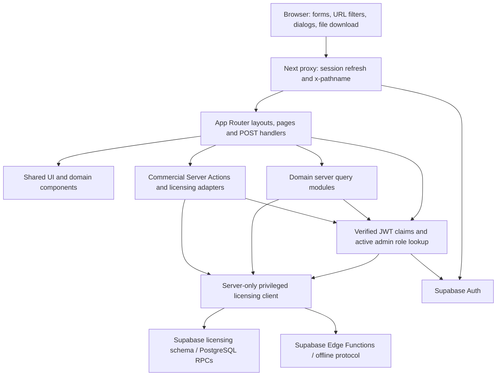

# Dashboard architecture audit

Audited 18 November 2026 (Africa/Cairo). Baseline commit: `d17674a8e5eccf9a5e9c8731f9284ece34bb2317`.

## 1. Executive summary

The application is a server-rendered Next.js licensing administration dashboard with domain-oriented query modules, shared presentation components, and a Next.js backend-for-frontend (BFF). It is not yet Feature-Sliced Design (FSD). Supabase is used for identity, privileged database reads, commercial RPC mutations, and licensing Edge Functions. The browser does not directly read licensing tables.

The three highest-impact migration findings are:

1. **A01 — High: the backend contract is incomplete in this repository.** Five PostgreSQL RPCs and three Edge Functions own commercial and offline licensing behavior. SQL, RLS, triggers, grants, signing logic, and transaction implementations are absent. A table-for-table Laravel/MySQL replacement would not establish behavioral parity.
2. **A02 — High: no automated regression suite is checked in.** Login/RBAC, one-time license codes, atomic provisioning, activation bytes, and renewal retries have no executable acceptance coverage here. Historical acceptance statements in README are not current test results.
3. **A03 — High migration risk: FSD CLI page conventions differ from the current router.** Installed CLI 2.8.0 generates `page.route.tsx` and `src/pages` slices; this app discovers ordinary `page.tsx` with default configuration. Blind generation or changing extensions can drop routes or expose FSD internals through the Pages Router.

Preserve the existing authorization boundary, server rendering, URL filters, Arabic/English UI, and binary licensing protocol. Start with **Plans (`/plans`)**, which has a filtered read plus create/edit operations. First move architecture while retaining Supabase; then replace its adapter with a separately verified Laravel contract. Do not combine auth migration, page-extension changes, database migration, and UI redesign in one batch.

Lint, standalone TypeScript and the credential-free isolated production build passed. Results and remaining limits are recorded in section 9. Only this report is an intended repository change.

## 2. Audit scope, evidence, and verification limits

### Baseline

| Item | Observed evidence |
| --- | --- |
| Working tree | Clean at audit start (`git status --short` returned no entries). No application edits made. |
| Instructions | Root `AGENTS.md:1-11`; `CLAUDE.md:1` points to it. No nested AGENTS files found in the source inventory. Installed Next.js guides were read before making recommendations. |
| Package manager | npm: committed `package-lock.json`, lockfile version 3, npm commands in README. No `packageManager` pin in `package.json:1-31`. |
| Next.js / React | Declared, locked, and installed: Next.js 16.3.4; React / React DOM 19.2.8. |
| Supabase | Declared `@supabase/ssr ^0.12.7`, `@supabase/supabase-js ^2.116.0`; locked and installed 0.12.7 / 2.116.0. |
| Toolchain | Tailwind 4.3.3, TypeScript 5.9.3, ESLint 9.39.5 locked and installed. Declarations use major ranges; `eslint-config-next` is 16.3.4. |
| Router | `src/app` App Router, `(dashboard)` route group, two dynamic ID segments, `src/proxy.ts`; no Pages Router source today. `next.config.ts:1-7` is effectively default. |
| Type/lint configuration | Strict TypeScript and `@/* -> ./src/*` (`tsconfig.json:2-27`); Next core-web-vitals + TypeScript ESLint presets, no FSD import enforcement (`eslint.config.mjs:1-23`). |
| CSS/build | Tailwind v4 PostCSS integration (`postcss.config.mjs:1-7`), four Google font families (`src/app/layout.tsx:2-34`). |
| FSD tooling | Global `fsd --version`: 2.8.0. No project FSD config, ownership manifest, Steiger setup, or local CLI dependency found. Global installation is not a project dependency guarantee. |
| Size | 87 TS/TSX source files, plus global CSS and favicon; 7,624 source text lines including CSS. 12 explicit client entry files. |

Inspected README, both existing security/auth documents, `src/features/README.md`, package manifest/lock, framework/TS/ESLint/PostCSS configuration, all route surfaces, auth/environment helpers, query modules, mutations, upload/download adapters, shared UI, navigation, and localization. Existing documentation contains stale descriptions (A11); source wins when they disagree.

No `.env.local` values, credentials, signing keys, production data, or Supabase project were read. `.env.example` was inspected as the variable-name/template contract only; no values are reproduced here. No live backend requests were intentionally made. SQL and Edge implementation files are not checked in; README identifies the sibling POS repository as their owner, but that repository was outside this audit. No claim is made about deployed RLS, indexes, transaction safety, or production availability.

A TypeScript-parser inventory resolved 313 internal static import/re-export edges across the 87 TS/TSX files. It found **zero cycles in that graph**, including type imports. This excludes runtime/dynamic imports and external-package internals; it is not an FSD architecture-lint pass. Five files with no static inbound imports are candidates, not proven deletions (A12).

Relevant references: installed Next.js `node_modules/next/dist/docs/01-app/03-api-reference/03-file-conventions/{page,route,proxy,src-folder}.md`; the FSD CLI skill's architecture and Next.js guidance; [FSD CLI generator documentation](https://fsdcli.me/docs/slice-generator). The installed CLI implementation, not marketing examples, was used to verify route output.

## 3. Current architecture diagram and route/flow inventory

### Responsibility map

| Current path | Actual responsibility / ownership |
| --- | --- |
| `src/app` | Routing, security composition, page orchestration, table definitions, some business predicates and bilingual copy; routes are more than wrappers. |
| `src/components/ui` | 17 generic presentation files: tables, filters, pagination, dialogs, status and page structures. |
| `src/components/layout` | Shell, header, sidebar, environment badge. Client shell receives server-rendered children. |
| `src/components/{auth,commercial,activation,customers,overview}` | Domain UI, form state, file workflow, renewal preview, customer tabs, server-rendered charts. Not colocated with domain data. |
| `src/features/*/server` | Seven read domains (`overview`, `customers`, `plans`, `subscriptions`, `licenses`, `operations`, `history`), one commercial mutation module, one activation Edge adapter. `features/shared` is generic query infrastructure rather than a business feature. |
| `src/server` | Session identity, role authorization, environment policy, Supabase constructors, authorized data access, locale cookies, origin checking. |
| `src/lib` | Browser-safe utilities, formatting, navigation, redirect handling, public env lookup and unused browser Supabase constructor. |
| `src/types` | Hand-maintained database facade, RBAC, environment and navigation types. |
| `src/i18n` | Typed Arabic/English dictionary, locale/direction helpers and environment-dependent message rewriting. |

### Complete route inventory

File references below are relative to the repository. All dashboard page files live under `src/app/(dashboard)/`; the route group does not add a URL prefix. All list routes use a fixed 20-row page size and exact count; filters are GET query strings.

| URL | Page file / loader | Current behavior and query parameters |
| --- | --- | --- |
| `/` | `src/app/page.tsx:1` | Redirects to `/dashboard`. |
| `/login` | `src/app/login/page.tsx:12` | Email/password login, sanitized `next`; existing identity redirects without performing RBAC here. Missing auth config gets controlled UI. |
| `/dashboard` | `dashboard/page.tsx:29`; `features/overview/server/get-overview-data.ts:53` | Eight KPIs, six-month growth, six recent customers, eight recent activation requests. |
| `/customers` | `customers/page.tsx:22`; `getCustomers` | `page`, `search`, `status`; create customer for owner/admin, links to 360. |
| `/customers/[customerId]` | `customers/[customerId]/page.tsx:110`; `getCustomerDetail` | Overview/subscription/licensing/history tabs; provisioning and finite same-device renewal. Invalid/missing UUID returns framework not-found. |
| `/plans` | `plans/page.tsx:63`; `getPlans` | `page`, `enabled`, `lifetime`; four global summary counts; owner/admin create/edit dialog. |
| `/subscriptions` | `subscriptions/page.tsx:88`; `getSubscriptions` | `page`, `status`, `plan` (UUID); global counts and plan options; customer context links. |
| `/licenses` | `licenses/page.tsx:18`; `getLicenses` | `page`, `search`, `status`; search first finds up to 200 matching customers. |
| `/licenses/[licenseId]` | `licenses/[licenseId]/page.tsx:27`; `getLicenseDetail` | Customer/subscription/devices/request/issuance/audit context, eligible unused-code rotation for owner/admin, section anchors. |
| `/activation-requests` | `activation-requests/page.tsx:53`; `getActivationRequests` | `page`, `status`; upload/verify/issue workflow for owner/admin/support, request list and guide. |
| `/devices` | `devices/page.tsx:18`; `getDevices` | `page`, `status`; contextual license/customer links. Read only. |
| `/issuances` | `issuances/page.tsx:17`; `getIssuances` | `page`, `reason`; revision and issuance metadata. Read only. |
| `/audit-logs` | `audit-logs/page.tsx:27`; `getAuditLogs` | `page`, `action`; metadata and related customer/license links. Read only. |
| `/settings` | `settings/page.tsx:7` | Environment and access-management information. No admin-user editor or settings mutation. |

There are **14 page routes, 4 POST Route Handlers, 2 layouts, 1 proxy**, plus framework favicon handling. No parallel/intercepting routes, middleware.ts, custom provider tree, custom not-found, or additional HTTP methods were found.

| Other surface | Responsibility |
| --- | --- |
| `src/app/layout.tsx:41` | Validates environment, awaits locale cookie, sets `html lang/dir`, fonts, metadata and global CSS. Applies to public pages too. |
| `src/app/(dashboard)/layout.tsx:11` | Requires verified identity + active admin row before rendering shell; redirects anonymous users or renders generic access denied. Loaders also guard data separately. |
| `src/app/(dashboard)/loading.tsx:5` | Shared localized skeleton, shaped like overview even on other modules. |
| `src/app/(dashboard)/error.tsx:12` | Client error boundary with retry; many loaders are caught locally instead. |
| `src/app/global-error.tsx:21` | Root-level controlled error screen, no raw error message in UI. |
| `src/proxy.ts:26-64` | Refreshes session, propagates cookies and pathname; matcher includes pages and APIs, excluding common assets. No RBAC decision here. |
| `src/app/api/locale/route.ts:4` | Public POST `{locale: "ar"|"en"}`; HTTP-only, lax, year-long cookie; header refreshes current route. |
| `src/app/api/activation/verify/route.ts:12` | Operator-only multipart upload; verifies then loads database context. |
| `src/app/api/activation/issue/route.ts:9` | Operator-only JSON `{requestId}`; returns binary attachment. |
| `src/app/api/renewal/issue/route.ts:9` | Owner/admin-only JSON `{licenseId,planId,operationId}`; actor taken from verified server identity. |

Six exported Server Actions exist in two `"use server"` modules: `signInAction`, `signOutAction` (`src/server/auth/actions.ts:18,44`), and `savePlanAction`, `createCustomerAction`, `provisionSubscriptionAction`, `rotateLicenseCodeAction` (`src/features/commercial/server/actions.ts:75,153,210,269`). They are remotely invocable boundaries, not ordinary browser imports of server implementations.

### Flow 1: login and session

`/login` awaits `searchParams` and sanitizes `next` → `LoginForm` uses `useActionState` and form pending state → `signInAction` trims email, validates presence, constructs cookie-aware Supabase client, calls `signInWithPassword`, returns `missing_credentials` / `not_configured` / `invalid_credentials`, or redirects. Sign-out clears Supabase session then redirects; its error result is not checked (`src/server/auth/actions.ts:44-47`).

Proxy `getClaims()` refreshes cookies; Server Components read cookies with `getSupabaseServerClient` and tolerate inability to write them. `getCurrentUser` verifies JWT claims with request memoization (`current-user.ts:28-37`). `requireAdminAccess` uses verified `sub` to read `admin_users(role,status)` through the privileged client (`require-admin-access.ts:14-56`). Missing, disabled, unknown role, query failure, or missing configuration fails closed. Roles are owner/admin/support/viewer; authorization is independent of email or user metadata. No public signup/reset flow is implemented.

`requireUser` builds the login return path from proxy `x-pathname`; the proxy passes only pathname, so original list filters are lost on a session-expiry redirect (`src/proxy.ts:28`, `require-user.ts:32-36`). Sanitization rejects absolute and protocol-relative URLs and login loops, but backslash-normalized destinations need additional validation (A13).

### Flow 2: customer list with filters and pagination

`customers/page.tsx:22-36` awaits query params, parses page/search/status, resolves locale and permissions → `getCustomers` authorizes → PostgreSQL selects minimal customer fields, exact count, descending creation order, inclusive range → sanitized 80-character search spans business name/code/owner/email and recognized status values apply → second batched subscription query constructs a map → camelCase list DTO → server table, links, empty state, GET filter form and pagination.

Evidence: `features/customers/server/queries.ts:23-83`, `features/shared/server/query-helpers.ts:3-36`, `components/ui/filter-controls.tsx:7-20`, `components/ui/pagination.tsx:15-56`. Query failures throw a sanitized message; the page catches it and returns localized module error. Filters reset page by omitting it; pagination preserves non-empty filters. No client query cache or redundant client list store. Subscription selection inconsistency is A04; out-of-range page labeling is A09.

### Flow 3: plan create/update

`/plans` → `getPlans` runs four global counts, filtered/paginated plan query, then batched subscription counts → owner/admin gets `PlanDialog` → native `ActionDialog` contains `PlanForm` (`commercial-forms.tsx:179-226`) → `useActionState(savePlanAction)` plus local lifetime/duration state → server checks owner/admin again, parses FormData and validates name, finite duration, lifetime consistency, nonnegative price/currency and note length → `create_plan` or `update_plan` RPC with server actor ID → runtime object/outcome checks → typed action state → localized status message, `revalidatePath('/plans')` and `/customers`.

Evidence: `features/plans/server/queries.ts:5-51`, `features/commercial/server/actions.ts:75-150`, `components/ui/action-dialog.tsx:28-90`. The RPC returns JSON rather than a fully typed domain result; unknown failures become `unavailable`. Price parse weakness is A10. Backend code, uniqueness and transactional audit semantics cannot be verified here.

### Additional protocol flows: upload, issuance, renewal

Activation state is `idle → verifying → verified → issuing → issued`, with file/context/download state, pending guards and blob URL cleanup (`activation-workflow.tsx:120-207`). Browser checks extension and 64 KiB limit; server also checks role, same-origin, multipart file, MIME, size, fatal UTF-8 decoding and ELMOREQ marker (`api/activation/verify/route.ts:9-68`). The exact uploaded bytes, not reserialized JSON, reach `verify-activation-request` (`edge-functions.ts:14-33`). Accepted outcomes are `verifiedAndRecorded`, `alreadyRecorded`, `alreadyActivated`; the request ID then resolves authorized request/license/customer/device context. Verification is potentially a **write**, despite its name.

Initial issuance forwards `{requestId}` to `issue-initial-license`, preserves binary bytes, sanitizes the attachment filename, and returns `no-store`/`nosniff`. The UI triggers download and permits downloading the in-memory blob again; it does not refresh the server list afterward (A08).

Renewal filters finite plans, previews dates client-side, creates one operation UUID via ref, POSTs to the Next handler, forwards the verified actor to `renew-same-device-license`, receives binary plus optional `x-license-expires-at`, then refreshes route data (`renew-subscription.tsx:85-150`). Operation ID remains across retries and plan selection is disabled while pending or in error (`renew-subscription.tsx:186-189`); preserve this binding and confirm backend replay semantics. This is same-device finite renewal only, not device replacement. No Supabase Storage upload or realtime subscription is used; upload/download is an HTTP byte protocol.

## 4. Design patterns and code-quality findings

### Patterns actually implemented

| Pattern | Useful implementation | Cost / preservation guidance |
| --- | --- | --- |
| Server composition and slots | Shell `children` and customer tab ReactNode panels keep server-rendered content separate from client interaction (`dashboard-shell.tsx:17-52`, `customer-profile-tabs.tsx:8-82`). | Client shell does not automatically turn every child into a client component. All customer panels are nevertheless queried upfront; tabs are not lazy data boundaries. |
| Stateless privileged adapter + guard | `server-only`, private schema, disabled persistence/refresh; read guard repeats authorization (`privileged-client.ts:12-29`, `authorized-licensing-client.ts:6-12`). | Strong boundary worth retaining. It exposes a full Supabase client to callers rather than a domain repository interface. |
| Domain query facade / manual relational assembly | Named loaders batch foreign-key lookups with `Map` and `Promise.all`, e.g. licenses `queries.ts:42-87`. | Avoids per-row N+1 requests, but DTOs, SQL filters and aggregation all depend on Supabase details. Relations cross domains inside one loader. |
| Server Actions / command handlers | Commercial mutations validate permissions and input at entry, return status/code state, revalidate affected paths. | Four use cases and key-generation logic share a 305-line module; clients share a 412-line form module. Split by responsibility when migrating, preserving action boundaries and the renewal form’s existing retry-payload lock. |
| Request memoization | React `cache` for identity, authorization and overview (`current-user.ts:28`, `require-admin-access.ts:14`, overview `:53`). | Request/render deduplication, not a durable cross-user data cache. Do not replace with a global session singleton. |
| Generic table / composition | `DataTable<T>` takes columns and row keys; filtering and pagination remain in pages (`data-table.tsx:3-55`). | Good reusable UI. Do not add a client boundary around server-created render callbacks. |
| Local state machines | Activation phases, pending form state, renewal retry UUID and blob cleanup. | No Redux/Zustand/React Query provider overhead today. Keep state local unless reuse actually needs extraction. |
| Typed localization | Arabic dictionary conforms to English keys; locale rendered on server; explicit Cairo date formatting. | Copy also lives in pages/components; whole bilingual dictionaries and production rewrites are imported by client shell. Bundle size unmeasured. |

### Boundaries, coupling and type quality

Imports generally flow from route → components and domain server loaders → guarded infrastructure; no confirmed static import cycles. There are no slice `index.ts` public APIs. Examples of implementation coupling: `customers/page.tsx:11` deep-imports `features/customers/server/queries`; commercial UI imports four server actions from a shared implementation module (`commercial-forms.tsx:5-10`); renewal adapter lives inside `features/activation` despite serving commercial renewal. `features/shared` is a same-layer shared dumping point rather than FSD Shared. `src/lib/format.ts:1` imports a presentation type from `components/ui/status-badge`, reversing the intended utility/UI direction (type-only today).

`CustomerDetailPage` directly derives current subscription/license, renewal eligibility and provisioning eligibility (`:126-150`), while server SQL/Edge code must enforce the real rules. These display predicates should become explicit typed policy models with backend parity fixtures, not authority in the browser. Cross-domain aggregations belong to page compositions or explicitly owned read models; do not create entity-to-entity import webs while moving loaders.

Strict TS and inferred loader return types are strengths, but `types/database.ts:9-19` supplies `Insert/Update: Partial<Row>`, no relationships, and strings for status/role. RPCs return broad `Json`; HTTP results are asserted to interfaces without schema decoding (`activation-workflow.tsx:169`, `edge-functions.ts:28,53,90`). These are not generated or backend-validated contracts (A06).

Largest implementation units: commercial forms 412 lines; activation workflow 399; customer detail page 342; commercial actions 305; renewal UI 233; overview loader 213. The 508-line messages file and 403-line stylesheet are central assets, not automatically component-quality defects. A14 scopes useful extraction to independently owned responsibilities; file length alone does not prove a defect.

### Rendering, caching and performance

Pages are Server Components with awaited params/searchParams; locale/auth read async request cookies. No explicit persistent query caching, `use cache`, `unstable_cache`, custom fetch cache policy, or configured Cache Components was found. Licensing POST responses deliberately use `no-store`. Read data is loaded on the server; interactive islands cover forms, shell, tabs and file flows. Charts are server-rendered markup (`overview/dashboard-charts.tsx:1-25`), without a heavyweight chart dependency.

Static cost observations, **not measured latency or capacity**:

- Overview starts 11 parallel data queries (8 counts plus 3 datasets), followed by up to 2 relationship queries, apart from auth (`get-overview-data.ts:65-145`). Growth rows are aggregated in JavaScript with no explicit page/limit.
- Plans performs up to 6 data requests (4 counts + list + related subscriptions). Per-plan subscription totals count fetched rows, exposing backend row-limit risk (A05).
- Customer detail performs up to 9 data queries in 3 waves. All tabs' data is fetched before rendering; subscriptions/licenses/devices have no explicit paging. License detail requests/devices/issuances are also unpaged (`licenses/queries.ts:104-136`).
- Twelve explicit client entries and shared bilingual copy are potential JS costs. No browser bundle analyzer, Web Vitals, Lighthouse, load test, or query-plan measurement was run. Do not assign a performance percentage from these observations.
- Four Google font families are build-time external asset dependencies. A successful build does not measure actual font rendering or mobile layout.

## 5. UI and design-system baseline

The baseline is derived from source; no authenticated screenshot or browser acceptance was performed in this audit.

| Area | Preserve / evidence |
| --- | --- |
| Palette/theme | Light surface `#ffffff`, background `#f8fafc`, text `#0f172a`, primary `#0052ff`, dark sidebar `#0b1224`; semantic success/warning/danger/info/teal pairs (`globals.css:3-39`). No theme provider, dark mode or user theme switch. |
| Tokens | CSS variables for colors, radii 10/12/16px, shadows, rings, fonts; Tailwind `@theme inline` (`globals.css:41-51`). Some inline gradients/radii and slate/amber classes coexist; preserve before consolidating. |
| Typography | IBM Plex Sans, IBM Plex Sans Arabic, IBM Plex Mono, Calistoga; Latin body 14px/1.5, Arabic 15px/1.65 (`layout.tsx:8-34`, `globals.css:62-78`). |
| Shell | Sticky 256px sidebar, sticky header, main max-width 1500px; desktop sidebar at `lg`, mobile overlay below it (`dashboard-shell.tsx:21-52`, `sidebar.tsx:51`). |
| Responsive behavior | Tailwind default sm/md/lg usage; CSS explicitly hides mobile trigger at 1024px and transforms tables into labeled cards at <=899px (`globals.css:322-390`, `data-table.tsx:44`). Test the 900–1023px intermediate range too. |
| Navigation | **10 links**, grouped into workspace/operations/settings; operations are visible in sidebar (`navigation.ts:11-22`, `sidebar.tsx:46-88`). README's six-link description is stale. Keep all paths and active-link styling. |
| Reusable UI | PageHeader, PageSection, StatCard, DataTable, Pagination, filter controls/bar, EntityLink, DetailGrid, StatusBadge, EmptyState, ModuleErrorState, ActionDialog, SectionNav. Drawer/placeholder/table skeleton are currently unused candidates. |
| Locale/RTL | Default Arabic; `elmo_admin_locale` HTTP-only cookie, server `lang/dir`; no locale URL prefixes. English switch POSTs then refreshes (`get-locale.ts:5-8`, `api/locale/route.ts:25-33`). Logical start/end spacing, bidi technical values, directional icon rotations. |
| Numbers/dates | `ar-EG` / `en-GB`; Cairo timezone; operational numbers explicitly use Latin digits (`lib/format.ts:4-20,109-116`). Preserve null-as-dash and snapshot plan information. |
| Accessibility | Native commercial dialog uses `showModal`, labeled title, close/cancel cleanup. Visible focus ring and reduced-motion rule exist (`action-dialog.tsx:28-90`, `globals.css:90-100,394-403`). Renewal/mobile overlays and customer tabs have keyboard gaps (A07). |
| Operational states | Localized empty/error UI, group skeleton/retry, not-configured/login denied states, persistent environment indication, production warning, role-gated controls, one-time code warning/copy and exact binary file downloads. |

Before implementation, capture both locales at desktop and mobile widths for every route, including empty/error/loading/denied states, open dialogs, customer tabs, technical sections and long identifiers. Record filter application/reset, page links/back navigation, tab state on navigation, file pick/drop/remove/verify/issue/download again, pending controls, and clipboard success/failure. These are acceptance requirements; source review alone does not establish their visual correctness.

## 6. Supabase dependency matrix and Laravel/MySQL migration implications

### Identity, access and infrastructure

| Integration / location | Current operation and scope | Laravel/MySQL requirement / unresolved evidence |
| --- | --- | --- |
| `lib/supabase/client.ts:1-16` | Browser-client constructor with public configuration; no application callers found. | Candidate to retire after import verification; not evidence of direct browser table access. |
| `server/supabase/server.ts:16-37`; `proxy.ts:26-64` | Cookie-based SSR Auth, `getClaims`, password login/logout, refresh cookies. | Decide retained Supabase identity vs Laravel sessions/tokens; preserve redirect and session refresh behavior. If Sanctum chosen, define domain, CSRF, cookie, SSR forwarding and credential policy. Do not assume a contract exists. |
| `server/auth/require-admin-access.ts:14-56` | Lookup `licensing.admin_users` by verified JWT subject; only active known roles admitted. | Preserve user UUID mapping and disabled-role behavior. Laravel must enforce policies independently, not trust browser-supplied role/actor. |
| `server/supabase/privileged-client.ts:12-29` | Server secret client targets validated private licensing schema; bypass-capable path guarded in app. | Replace with server-authenticated Laravel calls and API authorization. Do not move privileged secrets or database access into the browser. |
| `server/env.ts:27-120` | Explicit staging/production project allowlist and runtime checks; no arbitrary URL fallback. | Define equivalent environment/API pairing and visible environment identity without losing fail-closed rules. Current root layout validation is not a wrapper around all Route Handlers. |
| `types/database.ts:21-232` | 9 table facades, 5 RPC signatures, empty Views/Enums/CompositeTypes. Manually maintained. | Produce reviewed contract/schema artifacts; empty types do not prove remote objects are absent. |

All authorized roles can read the dashboard; owner/admin/support can verify/issue initial activation; only owner/admin can change commercial records or renew. See `types/rbac.ts:1-44`. Queries do not add tenant/user predicates; this is a global staff dashboard in source. Customer IDs are relationship filters, not a demonstrated tenant boundary. **Backend confirmation required** on whether global scope is intentional and whether any hidden SQL-level tenant restriction exists. Do not invent tenant isolation or relax it during migration.

### Database read surface

Every domain query uses guarded privileged access. Default list ordering and every selected field are explicit in the cited modules; no `select('*')` is needed for the UI.

| Table / flow | Code locations | Data shape / semantics to preserve |
| --- | --- | --- |
| `customers` | customers `queries.ts:23-172`; overview `:78,103-108`; licenses `:16-22`; relationship lookups in operations/history | UUID/code/business/owner/contact/status; customer search covers four fields; related tables often return snake_case while customer list maps camelCase. Full detail includes address/tax ID/notes. |
| `plans` | plans `queries.ts:5-51`; subscriptions `:12-16`; customer detail `:114-118` | Code/name/duration unit+value/trial/lifetime/price/currency/enabled; filter options and enabled-plan selectors differ. Plan list returns `{total,summary,rows}` with subscriptionCount. |
| `subscriptions` | subscriptions `queries.ts:5-90`; customer detail `:97-128` | Dates/lifetime/status and immutable plan snapshots, external reference. Active means started and not expired (or lifetime); expiring means active, finite, expiry in next 30 days. Stored expired status is used separately. Global counters are independent of active list filters. |
| `licenses` | licenses `queries.ts:10-160` | Customer/subscription relation, status, device limit and highest revision; hash exists in facade but is not selected for UI. Preserve customer/plan/device context. |
| `device_activations` | operations `queries.ts:24-49`; customer detail `:133-138`; license detail `:116-120` | Device state/timestamps/type; full facade also describes public keys and fingerprints, which are not all returned by list DTOs. Preserve opaque IDs and relationships. |
| `activation_requests` | operations `queries.ts:52-128` | Request UUID, license/device links, received/consumed dates, status, app/protocol version; verification returns joined context. |
| `license_issuances` | history `queries.ts:5-40`; license detail `:126-130` | Revision, reason, algorithm/key ID, expiry/lifetime, document hash, request/activation links; facade additionally describes signed document and renewal operation ID. Do not return complete documents in generic list responses. |
| `audit_logs` | history `queries.ts:43-77`; detail loaders | Actor/action/linked IDs/JSON metadata/time; relationship fallback through license. Existing UI reads histories only; backend immutability is not established by source labels. |

Recognized filters: customers `active/suspended/archived`; licenses `draft/active/suspended/expired/revoked/replaced`; devices `pending/active/replaced/deactivated/revoked`; activation requests `pending/validated/consumed/rejected/expired`; issuance reasons `activation/renewal/replacement/administrative`. Subscriptions accept `active/expiring/lifetime/expired/suspended/cancelled/replaced/draft`, plus valid UUID `plan`. Audit action uses case-insensitive substring with whitespace converted to underscores. Unsupported filters are generally ignored, not rejected. `safeSearch` removes PostgREST grammar characters, collapses whitespace and truncates to 80; PostgreSQL `ilike` must be matched deliberately under MySQL collation, escaping, Unicode and case rules. Existing `_` wildcard semantics need a decision.

Pagination is one-based, fixed 20, translated to inclusive offset range, with exact filtered total; lists sort by creation date except plans by name, activation requests by received time, issuances by issued time. No unique tie-break sort is specified, so stable pagination at equal timestamps needs a future decision rather than silent drift. Laravel should return counts and related display fields without reproducing frontend join fan-out.

### RPC writes (all require owner/admin)

RPC inputs below describe current calls, **not an approved Laravel payload**. The server injects `p_actor_user_id`. Responses are JSON object outcomes decoded in actions, then converted into `{status,code,entityId?,licenseCode?}` for the UI.

| RPC / source | Current request | Response / migration requirements |
| --- | --- | --- |
| `create_plan`, `update_plan`; commercial actions `:75-150` | `p_name`, duration value/unit or null, lifetime, price/currency or null, enabled, notes, actor; update adds plan ID. | `created`/`updated` plus `planId`. Preserve enabled/lifetime rules and snapshots on existing subscriptions; verify backend policy for trial/code generation. |
| `create_customer`; `:153-207` | Business/owner/phone, nullable email/address/tax ID/notes, active/suspended status, actor. | `created` + `customerId`. Preserve customer-code creation, field constraints, audit entry and duplicate handling; no customer update action exists. |
| `provision_initial_subscription`; `:210-267` | Customer ID, plan ID, UTC midnight startsAt, SHA-256 license code hash, actor. | `provisioned` + `subscriptionId`; conflict retries at most 3. UI handles `subscriptionExists`, `customerInactive`, `planDisabled`. Subscription + initial draft license must be atomic; hidden SQL is needed to prove exact constraints. |
| `rotate_unused_license_key_hash`; `:269-305` | License ID, new SHA-256 hash, actor. | `rotated`, `notEligible`, `licenseCodeConflict` etc. Must atomically ensure strictly unused license; frontend eligibility is insufficient. |

License codes are generated server-side using 20 random bytes, Crockford Base32, `ELMO-` grouped form, then SHA-256 hashed (`actions.ts:16,47-72`). Only hash goes to RPC. Plaintext is returned once in action state and shown/copyable transiently. During Laravel migration decide whether Laravel becomes code-generation owner; preserve entropy, representation, hashing, collision retries, no plaintext persistence/logging and one-time response semantics. Never make the browser the source of an authoritative code/hash pair.

### Edge Functions and HTTP contracts

| Function / Next route | Current contract | Preserve in replacement |
| --- | --- | --- |
| `verify-activation-request` → `/api/activation/verify` | Browser multipart `file`; server forwards exact `application/octet-stream` bytes; JSON `{outcome?,requestId?}`; successful Next response `{ok:true,outcome,context:{request,license,customer,device}}`. | Byte integrity, protocol/version/signature checks, replay and already-recorded semantics, validation/recording transaction, role gates and joined context. Backend confirmation required for all cryptographic rules. |
| `issue-initial-license` → `/api/activation/issue` | JSON `{requestId}`; Blob + Content-Disposition from Edge; Next binary attachment. | Exact signed `.elmolic` protocol, algorithm/key identifiers, revision, expiry, idempotency/consumption policy, content hash and audit associations. No signing keys in frontend. |
| `renew-same-device-license` → `/api/renewal/issue` | `{licenseId,planId,operationId,actorUserId}` from server; binary Blob with optional `x-license-expires-at`. Browser cannot select actor. | Same-device restrictions, atomic revision advance, idempotent operation ID and stable retry bytes, finite date calculation, concurrent operations and audit history. Client date projection is an estimate; server expiry is authoritative. |

Activation/renewal Route Handlers return 403 for origin/auth/role, 400 for malformed input, 422 with `{error,outcome}` for domain failure; verify can return 502 `context_unavailable`. Downloads and helper JSON responses set `no-store`; downloads add `nosniff`. Some thrown infrastructure exceptions bypass those structured errors (A08). The origin helper supports forwarded host (`server/http/same-origin.ts:3-36`); deployment must establish trusted proxy/header handling. Locale POST uses a separate simpler origin check, not that helper.

No `.storage`, bucket URLs, realtime channels, subscriptions, or checked-in Storage policies were found. Binary files travel through Edge Functions; object URLs are local browser memory. There are no checked-in SQL migrations, RLS policies, grants, trigger bodies, Edge implementations or seed/schema tests. Documentation claims RLS + FORCE RLS and no browser grants, but those are **unverified backend assertions**, not evidence of current deployed policy.

### Proposed Laravel API surface — not an existing contract

Retain Next.js as a BFF for the first integration to preserve session/Server Action/UI behavior. Next's server adapters call Laravel; browser licensing URLs can remain unchanged. A direct-browser Laravel API is an alternative requiring an explicit cross-origin/session decision.

| Proposed API | Proposed normalized request / response |
| --- | --- |
| `GET /api/v1/admin/me` | Verified identity + active role context; anonymous/disabled/role failures explicit. Auth/session creation endpoints depend on identity decision. |
| `GET /api/v1/{customers,plans,subscriptions,licenses,devices,activation-requests,issuances,audit-logs}` | Per-screen filter names above, `page`, fixed/approved `perPage`; `{data,meta:{page,perPage,total},summary?}` with nested display context. Map once into existing DTOs. |
| `GET /api/v1/customers/{id}`, `/licenses/{id}`, `/overview` | Explicit 360/overview read models, `referenceNow` and documented limits/counts; unknown IDs map to current not-found. |
| `POST /api/v1/plans`, `PATCH /api/v1/plans/{id}` | `{name,durationValue,durationUnit,isLifetime,price,currency,isEnabled,notes}` → domain result and entity ID. Decimal representation must be agreed. |
| `POST /api/v1/customers` | Current normalized customer fields → customer ID/code. |
| `POST /api/v1/customers/{id}/initial-subscription` | `{planId,startsAt}` → subscription/license IDs and one-time code; idempotency contract required. Backend owns actor and transaction. |
| `POST /api/v1/licenses/{id}/rotate-unused-code` | Backend atomic eligibility check → one-time code. |
| `POST /api/v1/activation-requests/verify`, `/initial-issuances`, `/renewals` | Preserve byte protocol and logical request IDs; renewal accepts operation ID. Exact content/header/error compatibility must be specified before adoption. |

Suggested error envelope `{error:{code,message,fields?}}` must be translated to existing action/HTTP outcomes; these names are proposals, not currently implemented Laravel behavior. Confirm UUID preservation and foreign keys, code/hash uniqueness, null/lifetime constraints, UTC precision, Cairo display, month-end date arithmetic, decimal currency, plan snapshots, immutable audit history, signed-byte canonicalization, revision concurrency, and replay/idempotency. MySQL does not inherit PostgreSQL RPC/RLS behavior by copying tables. Identity/password migration or a forced reset strategy needs backend ownership; do not assume Supabase credentials are portable.

## 7. Proposed FSD mapping and pilot screen

### Concrete mapping

Targets are recommendations, not generated or applied files. Preserve page-local code where it has one consumer.

| Current source | Proposed owner | Route impact / risk |
| --- | --- | --- |
| `app/layout.tsx`, proxy, group layout/error/loading, all `app/api/**/route.ts` | App framework entry/composition; delegates to lower-layer APIs | Retain public route files and auth boundaries. Avoid putting a global session into a shared client store. |
| `app/(dashboard)/plans/page.tsx`, `features/plans/server/queries.ts` | `pages/plans/{ui,api}` initially; plan DTO in `entities/plan/model` when used across screens | Keep `/plans` and filter/query names; counts/columns/copy remain page-local. |
| `app/(dashboard)/customers/page.tsx`, `customers/[customerId]/page.tsx`, customers queries | `pages/customers`, `pages/customer-details` with page-local aggregate reads; reusable customer identity in `entities/customer` | Keep `/customers` and dynamic param `customerId`; do not force the 360 aggregate into a customer entity importing every other entity. |
| `components/customers/customer-profile-{header,tabs}.tsx` | Initially `pages/customer-details/ui` | Single-screen callers; widget extraction only after real reuse. Preserve tabs and server ReactNode slots. |
| Remaining dashboard pages + loaders | `pages/{overview,subscriptions,licenses,license-details,activation-requests,devices,issuances,audit-logs,settings}` | One-to-one screen owners; overview charts/activation guide stay with their page if not reused. Operations/history loaders split by caller responsibility, not folder count. |
| `components/layout/{dashboard-shell,header,sidebar,environment-badge}.tsx` | `widgets/dashboard-shell/ui` and model navigation; generic badge can stay there initially | App layout composes widget. Shell imports sign-out/switch-language feature APIs below it. |
| `components/auth/login-form.tsx`, `server/auth/actions.ts` | `features/sign-in` and `features/sign-out` with explicit server action entry APIs | Preserve `/login` action behavior; access-denied/not-configured can remain page/app-local. |
| `commercial-forms.tsx` + actions | `features/manage-plan`, `create-customer`, `provision-subscription`, `rotate-license-code` | Keep forms, validation, action handlers and result types within each interaction; share only generic dialog/field primitives. |
| `renew-subscription.tsx` + renewal Edge adapter | `features/renew-subscription/{ui,model,api}` | Keep client operation UUID, server policy check, preview/server expiry distinction. |
| `activation-workflow.tsx` + verify/initial Edge adapter | `features/activate-license/{ui,model,api}` | Keep exact bytes, lifecycle and BFF endpoints; do not make renewal a sibling feature import through activation. |
| `subscription-summary.tsx`, reused subscription/date/status models | `entities/subscription/{ui,model}` when reuse warrants; customer-only composition stays page-local | Entity imports Shared, not other features. |
| `types/database.ts` | Temporary `shared/api/supabase/database-types.ts` (server adapter implementation); domain DTOs in consuming entities/pages | Prevent database facade from becoming universal Laravel contract. |
| `server/auth/current-user.ts`, `require-admin-access.ts`, RBAC | `entities/session` server API/model with infrastructure in `shared/api` | Session is identity/policy, independent of sign-in UI. Every protected adapter continues server enforcement. |
| `server/supabase/*`, `server/data/*`, env helpers | Server-only `shared/api/{supabase,laravel}` transport and policy-aware session composition | Shared transport must not import features/entities upward; compose authorization at the domain/server entry. Keep privileged construction private. |
| `components/ui/*`, `lib/utils.ts`, domain-independent formatters | `shared/ui`, `shared/lib` | Remove type dependency from utility to UI by owning neutral tone types explicitly. Business status mapping belongs in entity/page models. |
| `features/shared/server/query-helpers.ts`, `server/http/same-origin.ts` | `shared/lib` / server-only `shared/api` helpers | No business feature imports into Shared. Separate browser-safe constants from server-only query helpers. |
| `i18n/messages.ts`, `server/i18n/get-locale.ts`, CSS/fonts | `shared/i18n`, App locale resolution, App styles/fonts | Client-safe dictionary exports separate from cookie-only entry. Preserve cookie name and request-scoped locale. |

### Import/public API rules

Use downward direction `app → pages → widgets → features → entities → shared`. Same-layer business slices should not depend on each other's internals. A page can compose several features/entities. App and Shared are sliceless; do not create artificial business slices inside Shared.

Expose narrow entry APIs such as `@/features/manage-plan` for client UI/types and an explicitly server-only entry for action/repository use. Avoid a mixed barrel that re-exports privileged server modules into client consumers. Domain DTOs should not derive public contract types from a Supabase query implementation. Split infrastructure constructors from authorization composition so lower layers do not import upper-layer session features. Preserve valid React Server Action imports from clients rather than falsely classifying them as server code bundled into browsers.

No generated placeholders should replace working components. Establish aliases and import rules before moving imports; use parser/Steiger checks once actually installed and configured. `fsd check` alone is not proof of import correctness.

### Next.js/FSD CLI compatibility decision

Installed global CLI `bin/generator.mjs:314-323,355-366` creates `src/app/<name>/page.route.tsx` with `@/pages/<name>` imports and a no-props wrapper. Current routes use `page.tsx`, async `searchParams`/`params`, `(dashboard)` authorization layout and dynamic IDs. Default generation would also place a new route outside the dashboard group. Merely renaming wrappers does not preserve search/ID props or the group gate.

A future team must choose and verify a coherent convention:

- Preserve current route wrappers and deliberately adapt CLI-generated page integration after a dry-run; or adopt the CLI template convention in a separately verified all-route change.
- If using `src/pages` for FSD, prevent Next's Pages Router from discovering implementation `.tsx` files. A route-extension strategy affects **all** page/layout/route/error/loading conventions, not just generated pages. Adding `pageExtensions` with only route extensions while leaving existing files unchanged can remove the dashboard.
- An alternative FSD source root needs both alias resolution and generator path verification: CLI page registration inspected here hardcodes `src/app`, so a root override must not be assumed to fix integration.

Use installed-version Next page/src-folder guides and [FSD CLI generator docs](https://fsdcli.me/docs/slice-generator), but trust a pinned CLI dry-run and actual build route manifest for the selected convention. No CLI generation, init, upgrade, config writing, or dependency installation was executed during this audit.

### Recommended pilot: Plans

**Batch A — architecture only, retain Supabase.** Establish the chosen route convention without broad route churn. Move Plans composition, read model and manage-plan UI/action into their owners; keep `/plans`, `page/enabled/lifetime`, global counts, plan form controls, locale copy, dialogs and RPC calls unchanged. Keep read-only support/viewer behavior and owner/admin gates on both UI and server entry. Split only the plan part of the commercial form/action module; do not migrate unrelated workflows.

Before/after checks: all 18 application URLs/method surfaces present; plan filters, reset/page links, create/edit success and validation, finite/lifetime toggle, enabled/disabled, price/currency/null states, forbidden direct action, backend failure, Arabic/English and mobile dialog. Snapshot read DTOs and generated SQL calls against safe fixtures. Run lint/typecheck/build and compare route manifests. Perform authorized staging create/edit only when a safe fixture backend is available. Architecture acceptance does not claim Laravel parity.

**Batch B — Laravel only.** Agree plan DTOs, policies, validation/error codes, decimal serialization, count scope and transaction/audit effects. Replace the server adapter behind the same public API, preserving Server Action state and UI. Test the same fixtures against Laravel/MySQL and compare results, including duplicates, disabled plans and existing subscription snapshot behavior. Verify Laravel denies unauthorized writes directly. Keep Supabase adapter available for a controlled rollback until parity is accepted; avoid dual writes without a separate data-consistency design.

## 8. Prioritized findings and phased migration plan

Severity expresses practical effect on this audit/refactor, not a vulnerability score. **Confirmed** means observable in source/tool results; **risk** means source-supported consequence not reproduced against backend/browser; **unverified** marks external assumptions requiring confirmation.

| ID / severity / confidence | Evidence (`file:line`) | Observed behavior → practical impact → recommended action |
| --- | --- | --- |
| **A01 High — confirmed dependency gap; backend semantics unverified** | `src/features/commercial/server/actions.ts:108,184,237,285`; `src/features/activation/server/edge-functions.ts:21,42,73`; `src/types/database.ts:16-19`; `README.md:6` | Five RPCs and three Edge calls without implementations/SQL in repo. UI relies on atomic provisioning, unused-code eligibility and signed protocol. A CRUD-only port risks data/protocol regression. Obtain versioned SQL, grants/RLS, triggers, Edge code, protocol vectors and database tests from owning team before porting behavior. |
| **A02 High — confirmed coverage gap** | `package.json:5-10`; tracked-file test/spec/SQL inventory (no matches) | No test script, framework/config or executable tests covering critical flows. Passing lint/types cannot detect role/retry/byte regressions. Add targeted characterization and staging contract tests during implementation; acceptance gates listed in sections 7/9. |
| **A03 High — confirmed convention mismatch; inferred route-loss risk** | `next.config.ts:1-7`; `src/app/(dashboard)/plans/page.tsx:63`; installed CLI `bin/generator.mjs:314-323,355-366` | Generator uses route suffix + FSD Pages path and wrapper without params outside protected group. Current config discovers ordinary Next files. Verify route-discovery/props/group strategy in isolation before any generation; compare every existing URL. |
| **A04 Medium — confirmed selection inconsistency; manifestation backend-dependent** | `src/features/customers/server/queries.ts:48-63`; `src/app/(dashboard)/customers/[customerId]/page.tsx:126` | List sorts subscriptions newest-first but overwrites map on every active row; last/oldest active wins. Detail uses first/newest active. With multiple active records list and 360 disagree. Define deterministic current-subscription rule, confirm SQL uniqueness, characterize both paths; fix separately from architecture move. |
| **A05 Medium — confirmed unpaged reads; inferred truncation/scale risk** | `src/features/plans/server/queries.ts:34-40`; overview loader `:103,194-212`; customers queries `:97-154`; licenses queries `:116-136` | Application counts fetched related subscriptions and aggregates growth rows with no explicit pagination; Supabase API row caps can silently truncate. Details fetch potentially large collections upfront. Confirm row-limit/config and dataset sizes; prefer backend aggregates, paged histories and explicit completeness metadata. No deployed truncation measured. |
| **A06 Medium — confirmed contract weakness** | `src/types/database.ts:9-19,165-228`; `src/components/activation/activation-workflow.tsx:169`; `src/features/activation/server/edge-functions.ts:28` | Handwritten facade and asserted HTTP results do not verify runtime schemas. Backend drift can compile and fail at runtime. Review DTO/error unions, generated API schemas and runtime decoding at adapter boundaries; retain database types only inside Supabase adapter. |
| **A07 Medium — confirmed missing handlers; accessibility impact inferred** | `src/components/layout/dashboard-shell.tsx:26-38`; `src/components/commercial/renew-subscription.tsx:165-170`; `src/components/customers/customer-profile-tabs.tsx:48-82` | Custom modal overlays lack explicit Escape/focus trap/restore/inert behavior; tabs lack arrow-key/roving-tabindex handling. Keyboard use can diverge from commercial native dialog. Reuse the native modal approach where appropriate, implement tab keyboard behavior and verify in both directions before changing baseline interactions. |
| **A08 Medium — confirmed error/refresh gaps** | `src/app/api/activation/verify/route.ts:43-55`; issue `route.ts:32`; renewal `route.ts:40`; `activation-workflow.tsx:198-204`; `renew-subscription.tsx:134-136` | Infrastructure/context exceptions are not uniformly caught in Route Handlers; successful activation does not refresh list/context, unlike renewal. Clients discard most domain outcomes into generic errors. Preserve existing outcome contract, map failures consistently, and refresh affected views after accepted mutations; test retry after commit-but-response-failure. |
| **A09 Low — confirmed pagination edge case** | `src/features/shared/server/query-helpers.ts:5-8,20-22`; `src/components/ui/pagination.tsx:31-44` | Positive huge/out-of-range pages are not clamped before querying; displayed page is clamped but range uses original page. Empty results can show a range start above total. Define invalid/out-of-range URL handling, upper bounds and matching labels in a separate behavior change. |
| **A10 Medium — confirmed validation ambiguity** | `src/features/commercial/server/actions.ts:27-30,90-101` | Blank and invalid/nonfinite price both parse as null; a forged `price=abc` is accepted as unpriced, bypassing currency validation. Browser number input reduces normal-user exposure; SQL behavior unknown. Distinguish omitted price from invalid price in server validation and agree decimal limits with Laravel; characterize existing UI first. |
| **A11 Low — confirmed documentation drift** | `README.md` Architecture/Current phase navigation claims; `src/features/README.md:1`; `src/server/auth/current-user.ts:9-10`; `src/components/layout/sidebar.tsx:82-88` | Docs say reserved feature modules/six-link navigation or authorization not implemented; source has live server modules, RBAC, ten sidebar links. Incorrect baseline can lead to accidental removal. Reconcile docs during an authorized documentation update; this audit records source truth without editing them. |
| **A12 Low — candidate dead code** | `src/lib/supabase/client.ts:1`; `src/components/ui/{detail-drawer,module-placeholder,table-skeleton}.tsx:1`; `src/types/navigation.ts:1` | Five files have no inbound static edges. They increase apparent migration scope and unused browser-client assumptions. Confirm external/framework consumers before removal; none deleted here. |
| **A13 Medium — confirmed sanitizer gap; redirect exploitability unverified** | `src/lib/redirect-target.ts:11-18`; `src/server/auth/actions.ts:21,40`; `src/proxy.ts:28` | Sanitizer checks `/`, `//`, `://`, login paths but not backslashes/control characters. A slash-backslash host-like path passes source checks and can normalize differently in URL processing. Validate parsed same-origin destinations and add negative cases before refactor. Also explicitly decide whether auth redirects should preserve filters, which currently disappear. No hostile redirect was executed. |
| **A14 Medium — confirmed ownership/import debt** | `src/components/commercial/commercial-forms.tsx:1-412`; commercial actions `:1-305`; customer detail `:126-150`; `src/lib/format.ts:1` | Multi-use-case files and page-local business policy are spread across components/features/server/types. Public APIs are absent. Migration can turn folder moves into persistent cross-slice coupling. Apply the concrete mapping and server/client entry rules in section 7; keep single-caller page composition local. |

### Phased execution plan (future work)

1. **Freeze the behavior contract:** capture route/method manifest, both locales and responsive states, role matrix, DTOs/outcomes and binary fixtures. Resolve A01/A03 before backend port or page generation; establish targeted tests for A02.
2. **Plans architecture pilot:** preserve Supabase, isolate page/interaction/transport ownership, verify APIs and route manifest. Avoid introducing global stores or query libraries without a demonstrated need.
3. **Plans Laravel pilot:** implement reviewed MySQL schema and API policy, validate equivalent reads/mutations/errors/snapshots, then replace adapter. Resolve decimal/validation contracts first.
4. **Read-only domains incrementally:** customers list/detail, subscriptions, overview, licenses/operations/history; give cross-domain read models explicit ownership. Resolve aggregation/completeness and deterministic selection with separate acceptance changes.
5. **Commercial writes and licensing protocol:** obtain backend SQL/Edge implementation tests; port atomic provisioning/code rotation and activation/renewal with concurrency, idempotency, cryptographic compatibility and rollback validation. Do not use real production customers as fixtures.
6. **Identity cutover and retirement:** migrate/retain identity per approved session design, validate disabled roles and permissions directly at API, verify environments, then remove unused Supabase paths only after all consumers and rollback criteria are satisfied. UI cleanup and accessibility corrections should remain reviewable changes with their own baselines.

## 9. Verification results and open decisions

### Commands and coverage

Commands were reviewed before execution. Source-inspection commands (`rg`, `nl`, `cat`, file inventories, TypeScript AST traversal, package JSON reads) inspected files only; no backend behavior was exercised. No dependencies were installed, configuration edited, tests invented, SQL run, or production system queried.

| Command / check | Result | Reached application? |
| --- | --- | --- |
| `git status --short`; `git rev-parse HEAD` | Clean initial baseline; commit recorded above. | Repository only. |
| `npm run lint` | Exit 0; no diagnostics. Script is plain `eslint`. | Static application source checks. |
| `./node_modules/.bin/tsc --noEmit --incremental false` | Exit 0; no diagnostics. `--incremental false` avoids a workspace tsbuildinfo write. | Static source/types with existing Next generated declarations; not runtime. |
| `fsd --version` | Exit 0: 2.8.0. Read installed generator source for page behavior. | Tool only; no generation or FSD compliance validation. |
| TS AST import graph | 87 TS/TSX files, 313 resolved internal static edges, zero graph cycles, five no-inbound candidates. | Static source; dynamic imports/external internals excluded. |
| Test discovery (`rg --files` test/spec/SQL patterns, scripts inspection) | No checked-in tests/test runner/test script; no SQL files. No executable test command available. | No runtime flow coverage. |
| First isolated `npm run build` | Exit 1: Turbopack rejected temporary `node_modules` symlink pointing outside filesystem root. Setup blocker, not application defect. | Did not compile application. |
| Second isolated `npm run build` | Exit 0: compile, TypeScript, page-data collection, static generation and optimization completed. Dependencies were copied locally into the temporary tree to remove the symlink blocker. | Built application source; did not exercise authenticated backend flows. |

The build uses a temporary copy of tracked files at `/var/folders/yr/k35qy9b93hv45grp2h7nj31h0000gn/T/dashboard-audit-k6elqqbm`, excluding all `.env*` files, with locally copied installed dependencies. This protects local configuration and avoids using Supabase credentials; generated build/type outputs stay outside the repository. It checks the same tracked application source, not environment-specific deployment configuration. No dev server or authenticated browser was started.

**Final build result:** passed. Next.js reported all 14 page routes and 4 POST handler paths, plus framework `/_not-found`, with Proxy present. All listed routes were classified dynamic/server-rendered on demand. Compilation reported 6.5 seconds, TypeScript 3.4 seconds and static-page generation 168 ms; these are local build diagnostics, not request latency, bundle size or production performance.

### Current coverage gaps / required future acceptance

No automated coverage exists here for login/logout/session expiry, inactive/missing role denial, viewer/support write denial, data filters/counts, create/update validations, provisioning transaction/collision handling, plaintext code lifecycle, `.elmoreq` verification, signed `.elmolic` compatibility, renewal idempotency/concurrency, UI keyboard behavior or Arabic/mobile visual parity. README's prior Staging/Production acceptance is historical documentation only. No production acceptance, tenant isolation, RLS verification, backend migrations, load/capacity measurement, real MySQL or deployed Laravel integration was performed.

### Open decisions before implementation

| Owner | Decision / evidence needed |
| --- | --- |
| Frontend | Preserve normal Next wrappers or adopt route suffix convention? Where will FSD Pages live without Pages Router discovery? Verify grouping, dynamic props, proxy and all generated outputs with pinned CLI dry-runs. |
| Frontend | Define client/server public entries, page-local read models and session policy ownership. Keep native forms/local state unless a new need justifies library additions. |
| Frontend + product | Is navigation's current ten-link source behavior authoritative despite README? Which existing bugs should be fixed separately (subscription selection, page labels, stale activation data, keyboard behavior)? Preserve UI before approved behavior corrections. |
| Backend | Provide versioned licensing SQL/RLS/grants/triggers/functions, Edge source, tests, row caps, indices and protocol fixtures. Confirm uniqueness of active subscriptions, role scope and any tenant rules. |
| Backend | Choose transaction/idempotency guarantees, replay recovery and conflict outcomes for provisioning, rotation, issuance and renewal; confirm audit actor preservation and immutable histories. |
| Frontend + backend | Retain Supabase Auth or replace with Laravel identity? Define UUID mapping, passwords/reset, revocation, CSRF/cookies/CORS, SSR credentials, proxy trust and environment isolation. |
| Frontend + backend | Agree API versioning, snake/camel mapping, nullable fields, decimal price representation, status enums, exact totals/summary scope, complete vs limited history, stable sort and Unicode search semantics. |
| Licensing/backend | Preserve signing algorithm, key IDs, exact canonical bytes, expiry/month arithmetic, revision progression and POS acceptance. Decide signing service ownership without exposing keys to frontend. |
| Operations | Safe staging fixtures and test accounts by role; cutover/rollback plan; endpoint identity and hosting. Production deployment status is not established by this audit. |

Deliverable: `docs/DASHBOARD_ARCHITECTURE_AUDIT.md`. Recommended pilot: **Plans**, architecture first with Supabase, Laravel integration second. Application behavior and configuration remain unchanged by this audit.
